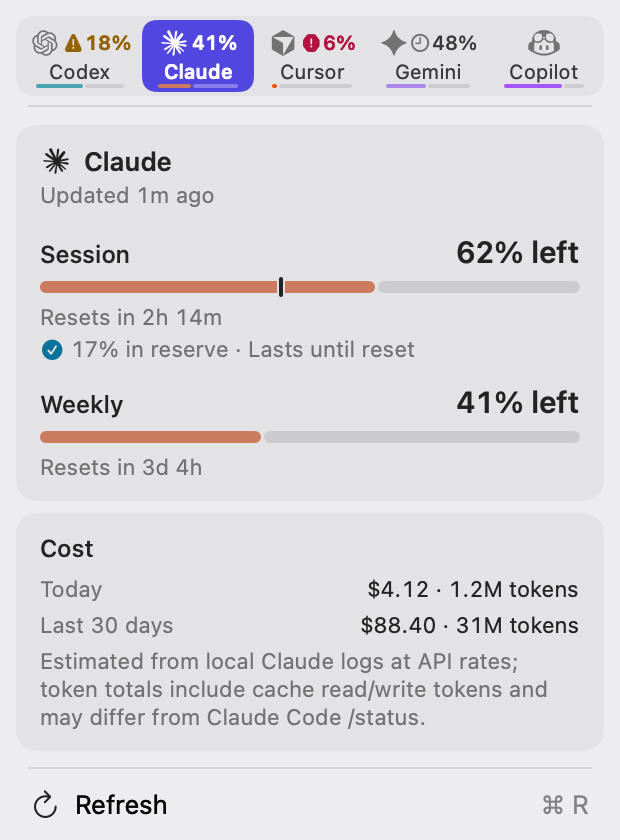
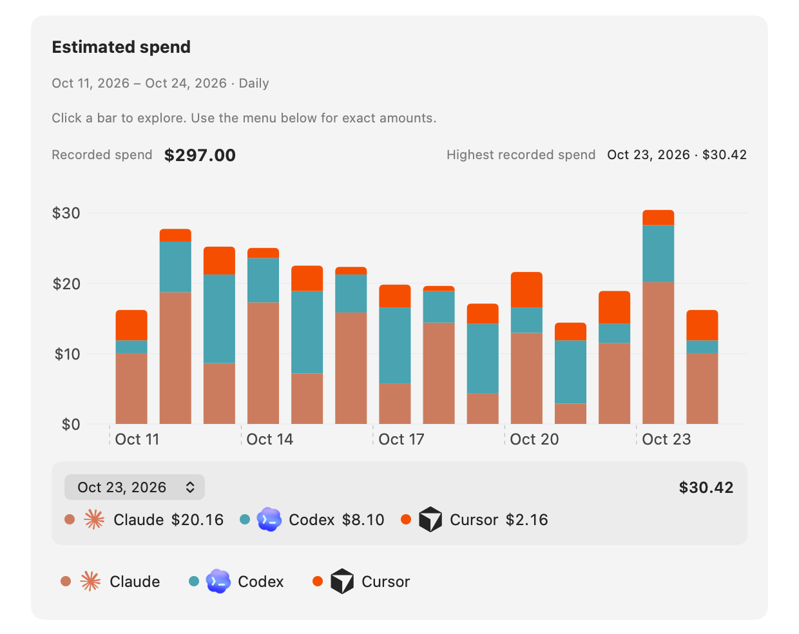
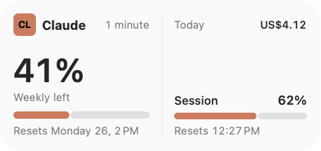

# OpenBar

**Every AI coding limit in your Mac's menu bar — light on memory, quiet by design.**

[](#install)
[](https://github.com/SergeSerb2/OpenBar/releases/latest)
[](LICENSE)


OpenBar shows how much of your AI plans you have left — session and weekly limits, credits, spend, and the time until
each limit resets — for Codex, Claude, Cursor, Gemini, Copilot, and 100+ other providers. It lives in the menu bar,
keeps your credentials on your Mac, and uses much less memory than the app it grew from.

Based on [CodexBar](https://github.com/steipete/CodexBar) by Peter Steinberger.

<p align="center">
  <picture>
    <source media="(prefers-color-scheme: dark)" srcset="docs/screenshots/openbar-menu-dark.png">
    
  </picture>
  &nbsp;
  <picture>
    <source media="(prefers-color-scheme: dark)" srcset="docs/screenshots/openbar-usage-spend-dark.png">
    
  </picture>
</p>

## What it does

- **Limits at a glance.** The menu bar icon shows your session and weekly quota as two meters. Open the menu for
  each provider's limits, reset countdowns, pace ("lasts until reset" or "runs out in 2h"), credits, and plan.
- **109 providers.** Coding plans, API platforms, gateways, and local tools. Show one icon per provider, or merge
  them into one icon with a switcher.
- **Local cost tracking.** OpenBar reads your local Codex, Claude, and other agent logs to estimate tokens and spend.
  **Settings → Usage & Spend** shows daily trends by provider, model, project, and session.
- **Alerts.** Get a notification before a quota runs out, and see provider incidents on the icon.
- **Widgets.** Desktop and Notification Center widgets for your providers.
- **Command line.** The `openbar` CLI (macOS and Linux) prints the same data as text or JSON for scripts, status
  bars, and dashboards.
- **23 languages,** including right-to-left layouts.

<p align="center">
  <picture>
    <source media="(prefers-color-scheme: dark)" srcset="docs/widgets/07-openbar-usage-wide-dark.png">
    
  </picture>
</p>

## Why OpenBar

**Lightweight.** OpenBar targets under 100 MB of memory in steady use and never more than 200 MB.

- Cost scans run in a short-lived helper process. The app receives only the results, and macOS gets all scan memory
  back when the helper exits.
- No chart or meter uses SwiftUI `Canvas` or Swift Charts. On macOS 26 and later these draw through Metal and commit
  about 97 MB of graphics memory the first time anything draws. OpenBar draws them with plain shapes.
- Closed windows let go of their content. Settings, inspectors, and chart submenus keep only their navigation state.

See [Performance](#performance) for measurements.

**An original design.** OpenBar has its own "Calm native" look: one Iris accent, the Open Ring app icon, a "Meter
bars" menu bar glyph, soft cards, a sidebar Settings window, and redesigned widgets. Status always comes with a symbol
and words, never color alone. The [design spec](docs/design/README.md) documents every surface.

**Audited.** Before 1.0, OpenBar went through a bug and security audit: 96 findings, 92 fixed. The fixes keep
credentials out of logs and error messages, bound plugin and local-server resources, lock config edits, and correct
usage parsing for dozens of providers. The [changelog](CHANGELOG.md) lists the fixes and the known issues that
remain.

## Install

1. Download `OpenBar-<version>.zip` from the [latest release](https://github.com/SergeSerb2/OpenBar/releases/latest).
2. Unzip it and move **OpenBar.app** to your Applications folder.
3. Open OpenBar. Its icon appears in the menu bar.

OpenBar needs macOS 14 or later and runs on Apple silicon and Intel Macs. Release builds are signed with a Developer
ID and notarized by Apple. OpenBar updates itself with [Sparkle](https://sparkle-project.org): it checks for updates
automatically, and **About → Check for Updates** checks now.

**First run.** Open **Settings → Providers** and turn on the providers you use. Each provider reads its data from one
or more sources: an existing CLI login, OAuth or a device sign-in, an API key, a browser session, or local files.
Each [provider guide](docs/providers.md) explains its sources.

OpenBar has its own bundle ID (`com.serbinenko.openbar`), settings, caches, and config file, so it can run next to
CodexBar without sharing state.

### Command-line tool

The app bundles the `openbar` CLI. To put it on your `PATH`, choose **Settings → Advanced → Install CLI**. This links
it as `openbar` in `/usr/local/bin` and `/opt/homebrew/bin`. From a clone of this repository you can run
`./bin/install-openbar-cli.sh` instead. Each release also has standalone CLI archives for macOS and Linux.

```bash
openbar                                   # usage for every enabled provider
openbar --provider claude --format json --pretty
openbar cost --provider codex             # local cost estimate from Codex logs
openbar config enable --provider cursor
printf '%s' "$ELEVENLABS_API_KEY" | openbar config set-api-key --provider elevenlabs --stdin
```

See the [CLI reference](docs/cli.md) and [CLI configuration](docs/cli-configuration.md).

## Supported providers

OpenBar supports **109 providers**. They include:

- **Coding plans and assistants:** Codex, Claude, Cursor, Gemini, Copilot, Antigravity, Droid, Kiro, Windsurf, Zed,
  Amp, OpenCode, Devin, JetBrains AI, and more.
- **API platforms and credits:** OpenAI, the Claude Admin API, OpenRouter, Mistral, DeepSeek, xAI, AWS Bedrock,
  Vertex AI, Fireworks, DeepInfra, and more.
- **Gateways and self-hosted proxies:** LiteLLM, Bifrost, sub2api, LLM Proxy, ClawRouter, and Wayfinder.
- **Regional plans:** z.ai, Kimi, MiniMax, Alibaba, Qwen Cloud, Doubao, StepFun, Xiaomi MiMo, and more.

Each provider has a setup guide with its sources, settings, and limits. Start at the
[provider overview](docs/providers.md). To add a provider, see the [provider authoring guide](docs/provider.md), or
write a [plugin](docs/plugins.md) without changing the app.

<details>
<summary><strong>All 109 providers</strong></summary>

- [Codex](docs/codex.md) — OAuth API or local Codex CLI, plus optional OpenAI web dashboard extras.
- [OpenAI](docs/openai.md) — Admin API key usage/cost graphs with legacy credit-balance fallback.
- [Azure OpenAI](docs/azure-openai.md) — API key, endpoint, and deployment validation probe.
- [Claude](docs/claude.md) — OAuth API, browser cookies, or CLI PTY fallback; session and weekly usage where available.
- [ClinePass](docs/clinepass.md) — API key for five-hour, weekly, and monthly subscription limits.
- [Cursor](docs/cursor.md) — Browser session cookies for plan + usage + billing resets.
- [OpenCode](docs/opencode.md) — Browser cookies for workspace subscription usage.
- [OpenCode Go](docs/opencodego.md) — Usage API, browser fallback, and local SQLite cost history.
- [Alibaba Coding Plan](docs/alibaba-coding-plan.md) — Web cookies or API key for coding-plan quotas.
- [Alibaba Token Plan](docs/alibaba-token-plan.md) — Bailian browser/manual cookies for token-plan credits.
- [Qwen Cloud](docs/qwen-cloud.md) — 5-hour and weekly individual Token Plan usage via browser/manual cookies.
- [Gemini](docs/gemini.md) — OAuth-backed quota API using Gemini CLI credentials (no browser cookies).
- [Antigravity](docs/antigravity.md) — Local language server probe, `agy` CLI HTTPS source, and Google OAuth fallback (experimental).
- [Droid](docs/factory.md) — Browser cookies + WorkOS token flows for Factory usage + billing.
- [Copilot](docs/copilot.md) — GitHub device flow + Copilot internal usage API.
- [Devin](docs/devin.md) — Chrome localStorage session or manual Bearer token for daily and weekly quotas.
- [z.ai](docs/zai.md) — API token for personal/team quota, MCP, 5-hour, and hourly usage windows.
- [Manus](docs/manus.md) — Browser `session_id` auth for credit balance, monthly credits, and daily refresh tracking.
- [MiniMax](docs/minimax.md) — API token, cookie header, or browser cookies for coding-plan usage.
- [T3 Chat](docs/t3chat.md) — Browser cookies capture for Base and Overage usage buckets.
- [ZoomMate](docs/zoommate.md) — Chrome cookie auto-import or manual cURL capture for credits usage.
- [Kimi](docs/kimi.md) — Auth token (JWT from `kimi-auth` cookie) for weekly quota + 5‑hour rate limit.
- [Kilo](docs/kilo.md) — API token with CLI-auth fallback for Kilo Pass usage.
- [Kiro](docs/kiro.md) — CLI-based usage; monthly credits + bonus credits.
- [Vertex AI](docs/vertexai.md) — Google Cloud gcloud OAuth with token cost tracking from local Claude logs.
- [Augment](docs/augment.md) — Augment CLI or browser cookies for credits tracking and usage monitoring.
- [Amp](docs/amp.md) — Browser cookie-based authentication with Amp Free usage tracking.
- [Ollama](docs/ollama.md) — API key access plus browser cookies for Ollama Cloud usage windows.
- [llmman](docs/llmman.md) — Local daemon memory used by loaded models, with an optional API key.
- [Synthetic](docs/synthetic.md) — API key quota endpoint for rolling five-hour, weekly token, and search-hourly usage.
- [JetBrains AI](docs/jetbrains.md) — Local XML-based quota from JetBrains IDE configuration; monthly credits tracking.
- [Warp](docs/warp.md) — API token for GraphQL request limits and monthly credits.
- [ElevenLabs](docs/elevenlabs.md) — API key for character credits and voice slot usage.
- [OpenRouter](docs/openrouter.md) — API token for credit-based usage tracking across multiple AI providers.
- [Windsurf](docs/windsurf.md) — Browser localStorage session import or local SQLite cache for plan usage.
- [Zed](docs/zed.md) — Zed editor Keychain session for plan, edit-prediction quota, billing cycle, and overdue invoices.
- [Perplexity](docs/perplexity.md) — Account usage credits from Perplexity usage data.
- [Xiaomi MiMo](docs/mimo.md) — Browser cookies for balance and token-plan usage.
- [Doubao](docs/doubao.md) — API key for Volcengine Ark request-limit probes.
- [Sakana AI](docs/sakana.md) — Manual Cookie header for 5-hour and weekly quota windows.
- [Abacus AI](docs/abacus.md) — Browser cookie auth for ChatLLM/RouteLLM compute credit tracking.
- [Mistral](docs/mistral.md) — Browser cookies for API spend, credit balance, and monthly-plan usage.
- [DeepSeek](docs/deepseek.md) — API key for credit balance tracking (paid vs. granted breakdown).
- [Fireworks](docs/fireworks.md) — API key + account slug for 30-day spend from the billing summary API.
- [Charm Hyper](docs/hyper.md) — Bundled plugin for native Hypercredit balance, using Chrome/manual sessions with API-key fallback.
- [DeepInfra](docs/deepinfra.md) — API key for prepaid balance, current-month spend, and spending-limit tracking.
- [Moonshot / Kimi API](docs/moonshot.md) — API key for Moonshot/Kimi API account balance tracking.
- [Venice](docs/venice.md) — API key for DIEM or USD balance tracking.
- [Codebuff](docs/codebuff.md) — API token (or `~/.config/manicode/credentials.json`) for credit balance + weekly rate limit.
- [Command Code](docs/command-code.md) — API key or browser/manual cookies for monthly USD credits and rolling usage limits.
- [Qoder](docs/qoder.md) — Browser or manual cookies for Qoder big model credit usage.
- [StepFun](docs/stepfun.md) — Username + password login for Step Plan rate limits (5‑hour + weekly windows) and subscription plan name.
- [AWS Bedrock](docs/bedrock.md) — AWS access keys or a named AWS profile (SSO/assume-role via the AWS CLI) for Cost Explorer spend, monthly budgets, and optional CloudWatch Claude activity.
- [Grok](docs/grok.md) — Grok CLI billing RPC plus grok.com browser-session fallback.
- [Groq](docs/groq.md) — Browser session for console spend and usage, with an Enterprise Prometheus API-key fallback.
- [LLM Proxy](docs/llm-proxy.md) — API key + base URL for aggregate proxy quota stats and provider breakdowns.
- [ClawRouter](docs/clawrouter.md) — API key for monthly budget, spend, requests, tokens, and routed-provider usage.
- [sub2api](docs/sub2api.md) — Self-hosted gateway key quota, subscription limits, wallet balance, and per-key usage.
- [Wayfinder](docs/wayfinder.md) — Local router gateway polling for health, per-route breakdown, savings, and decision latency.
- [LiteLLM](docs/litellm.md) — Virtual key + proxy URL for personal and team budget/spend tracking.
- [Bifrost](docs/bifrost.md) — Virtual key + self-hosted gateway URL for budgets, rate limits, and model spend.
- [Aixy](docs/aixy.md) — API key for key-scoped spend, tokens, and applicable personal/shared budgets.
- [Deepgram](docs/deepgram.md) — API key usage summaries across speech, agent, token, and TTS metrics.
- [Poe](docs/poe.md) — API key for current point balance and recent points history.
- [Chutes](docs/chutes.md) — API key for subscription usage, rolling and monthly quota windows, and pay-as-you-go quotas.
- [Neuralwatt](docs/neuralwatt.md) — API key for subscription kWh usage and prepaid credit balance.
- [Helmcode](docs/helmcode.md) — Cloud and NaN Builders dashboard sessions for per-model quotas and Cloud prepaid balance.
- [ZenMux](docs/zenmux.md) — Management API key for rolling five-hour and seven-day quota windows plus PAYG balance.
- [xAI](docs/xai.md) — Management API key + team ID for prepaid credit balance and daily platform spend.
- [IBM Bob](docs/ibm-bob.md) — API key for monthly Bobcoin budget and usage across subscription teams.
- [LongCat](docs/longcat.md) — Browser or manual cookies for token-pack quota and fuel-pack balances.
- [ai&](docs/aiand.md) — API key for 30-day organization spend from request logs.
- [Notion AI](docs/notion.md) — Browser or manual cookies for rolling and monthly workspace allowances.
- [Nous Portal](docs/nous.md) — Existing Hermes OAuth login for monthly credits and purchased top-ups.
- [Muse Code](docs/muse.md) — Existing Muse CLI login for subscription quotas, plus local token history.
- [Muse (muse.ai)](docs/museai.md) — Browser or manual muse.ai session for the Free, Power, or Maximum weekly allowance.
- [CodeRabbit](docs/coderabbit.md) — Local CLI usage report for review counts, billing state, and period resets.
- [Replicate](docs/replicate.md) — Browser or manual cookies for monthly spend and optional prepaid credits.
- [Hugging Face](docs/huggingface.md) — Access token for Inference Providers charges and optional ZeroGPU quota.
- [Raycast](docs/raycast.md) — Chrome or manual website session for monthly AI credits and renewal.
- [Pi](docs/pi.md) — Local Pi/OMP transcripts for token history and API-rate cost estimates.
- [v0](docs/v0.md) — Platform API key for billing and on-demand balances, plus rate limits.
- [TypeSafe](docs/typesafe.md) — Browser or manual console cookies for billing spend, balance, and credit expirations.
- [GitKraken AI](docs/gitkraken.md) — Account access token for personal weekly credits, reset time, and organization pool sharing.
- [DevPass](docs/devpass.md) — API key for plan credits, premium weekly allowances, and key-scoped spending.
- [Atlas Cloud](docs/atlascloud.md) — API key for the account's available USD balance.
- [Vercel AI Gateway](docs/vercel.md) — API key for the team's USD balance and lifetime spend.
- [xKiro](docs/xkiro.md) — API key for daily free-token usage, remaining allowance, and the midnight UTC reset.

<!-- Generated provider additions: Scripts/regenerate-provider-docs.mjs -->
- [Langdock](docs/langdock.md) — Selected Edge, Chrome, or Safari profile → personal included session and weekly limits (`web`, macOS).
- [Soniox](docs/soniox.md) — Organization API key for prepaid USD balance and monthly spend against the organization budget.
- [X API](docs/xapi.md) — Browser or manual console.x.com cookies for prepaid and free credits, including negative balances.
- [Future AGI](docs/futureagi.md) — API key and secret key (billing-period usage, allowances, and estimated cost).
- [LithosAI](docs/lithosai.md) — Browser or manual console cookies for prepaid USD balance and optional UTC spend.
- [WorkBuddy](docs/workbuddy.md) — Chrome or manual www.workbuddy.cn cookies for the monthly credits allowance, plan name, and cycle reset.
- [Tavily](docs/tavily.md) — API key for account-plan, per-key, and pay-as-you-go credit totals.
- [Linkup](docs/linkup.md) — API key for the current prepaid USD credit balance.
- [TinyApi](docs/tinyapi.md) — Browser or manual session cookies for aggregate available credits.
- [Exa](docs/exa.md) — Team Management service key plus an explicit API key ID for month-to-date USD spend.
- [Cosmic AI](docs/cosmic.md) — Explicit Personal Access Token and Project ID for separate project AI input/output counters and allowances.
- [Aerostack](docs/aerostack.md) — Explicit account JWT for monthly AI tokens used and the observed account allowance.
- [Sail Research](docs/sailresearch.md) — API key for organization credit balance and combined inference/Sailbox spend.
- [Sofya](docs/sofya.md) — API key for separate account plan and purchased credit balances, eligibility, and the reported monthly reset.
- [fal](docs/fal.md) — API key with billing read access for the current account credit balance.
- [FLORA](docs/flora.md) — API key with billing permission plus a workspace ID for the available USD balance and month-to-date spend.
- [Parallel](docs/parallel.md) — Browser session on platform.parallel.ai for the prepaid credit balance and pending debit.
- [Claude Platform](docs/claudeplatform.md) — Browser or manual platform.claude.com session cookies for Console API credit balance, expiring credit grants, and month-to-date spend.
- [Munito](docs/munito.md) — Admin API key with Read account data permission for today's and this month's spend against the organization's spend limits.
- [Trae CN](docs/traecn.md) — Browser session for account credit usage.
- [Chatbox AI](docs/chatbox.md) — API token
<!-- End generated provider additions -->

</details>

## Privacy and security

- **Credentials stay on your Mac.** API keys, pasted cookies, and token accounts are saved in the OpenBar config file
  (`~/.config/openbar/config.json`) with owner-only (`0600`) permissions. Some imported browser cookies and OAuth
  tokens are cached in OpenBar's own Keychain items. OpenBar never stores your browser or account passwords.
- **No telemetry.** OpenBar has no analytics or tracking. It connects to the providers you turn on, plus provider
  status pages, the update feed, [models.dev](https://models.dev) for model prices, and an exchange-rate service only
  when you choose a currency other than USD.
- **No disk crawling.** OpenBar reads a small set of known locations — provider config files, local agent logs, and
  browser cookie stores — and only for the features you turn on.
- **Browser cookies are opt-in.** Cookie import for a provider reuses your existing browser session. You can paste a
  cookie header or use an API key instead.
- **Keychain prompts are rare and explained.** Background refreshes do not ask for Keychain access, unless you opt in
  for Claude. A manual refresh can show at most one browser prompt, and a denial pauses further prompts for six
  hours. **Settings → Advanced → Disable Keychain access** turns off OpenBar's own Keychain use. See
  [Keychain prompts](docs/keychain-prompts.md).
- **macOS permissions.** Full Disk Access is optional and only needed for Safari cookies. Provider CLIs that OpenBar
  starts can cause a Files & Folders prompt for the folder they read. OpenBar does not ask for Screen Recording or
  Accessibility access.

Found a vulnerability? Please report it privately; see [SECURITY.md](SECURITY.md).

## Performance

We ran the same scripted scenario against CodexBar's code and OpenBar on one Mac:

<!-- PERF-NUMBERS: lead updates from final trials -->
| Same scripted scenario | CodexBar 0.80.1 code | OpenBar |
|---|---:|---:|
| Idle after startup | 165 MB | 65 MB |
| Settled after use | 190 MB | 104 MB |
| Peak | 383 MB | 156 MB |
| Graphics memory after a chart or menu draws | ~97 MB | under 1 MB |
| App bundle | 108 MB | 98 MB |

Memory is the Activity Monitor footprint, median of 3 runs. In the scenario the menu is opened and its tabs cycled,
Settings is opened and closed, a refresh is forced, and the app idles.

Cost scans run in the helper process, so their memory is not in the app's footprint and returns to macOS when each
scan ends. The [idle footprint notes](docs/research/idle-footprint-2026-10-24.md) describe the method and the raw
runs.

To run the scenario yourself, launch a build with `OPENBAR_MEMORY_PROBE_DIR=/some/dir`. OpenBar then runs the
scripted steps and writes the footprint at each step to `events.csv` in that folder. The probe does nothing unless
that variable is set.

## Build from source

You need macOS 14 or later and Xcode with Swift 6.2 or later.

```bash
git clone https://github.com/SergeSerb2/OpenBar.git
cd OpenBar
./Scripts/package_app.sh        # build OpenBar.app (ad-hoc signed)
open OpenBar.app
```

For day-to-day work, `./Scripts/compile_and_run.sh` builds, packages, relaunches the app, and checks that it keeps
running. `make check` runs the format, lint, and docs checks. See the [development guide](docs/DEVELOPMENT.md)
for logging, signing, and troubleshooting.

## Contributing

Bug fixes, provider fixes, new providers, and docs improvements are welcome. Read [CONTRIBUTING.md](CONTRIBUTING.md)
for setup, tests, and conventions, and [VISION.md](VISION.md) for what fits the project. Please follow the
[Code of Conduct](CODE_OF_CONDUCT.md). To report a bug or ask for a provider, use the
[issue forms](https://github.com/SergeSerb2/OpenBar/issues/new/choose).

More documentation: [configuration](docs/configuration.md) · [widgets](docs/widgets.md) ·
[architecture](docs/architecture.md) · [refresh loop](docs/refresh-loop.md) · [status polling](docs/status.md) ·
[Sparkle updates](docs/sparkle.md) · [releasing](docs/RELEASING.md) · [changelog](CHANGELOG.md).

## License and credits

OpenBar is released under the [MIT License](LICENSE). Copyright Peter Steinberger (CodexBar) and Serge Serbinenko
(OpenBar).

OpenBar is based on [CodexBar](https://github.com/steipete/CodexBar) by Peter Steinberger. It keeps CodexBar's
provider integrations, CLI, and docs, and CodexBar's release history stays in the [changelog](CHANGELOG.md). Tools
built for CodexBar's `codexbar` CLI can usually switch to `openbar`, which keeps the same JSON output.

Cost tracking was inspired by [ccusage](https://github.com/ryoppippi/ccusage). Third-party licenses are listed in
[THIRD_PARTY_LICENSES.md](docs/THIRD_PARTY_LICENSES.md).
